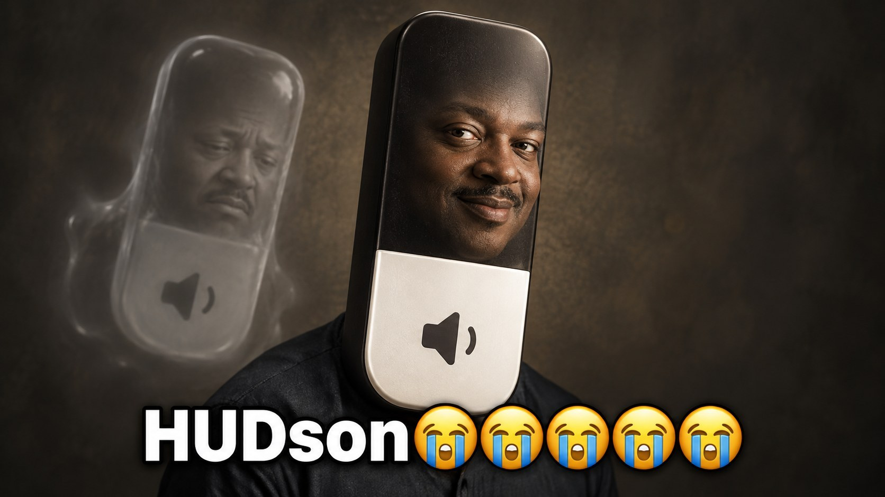

# HUDson

macOS Tahoe turned the volume and brightness HUD into a Liquid Glass blob. HUDson brings back a clean one.

It catches the volume and brightness keys before macOS does, so the glass pill never shows up, and draws its own little HUD instead.

- Volume, mute and brightness keys (Option+Shift for fine steps)
- Icons for AirPods, headphones and displays
- Top right, right edge or bottom center
- Fill that sloshes like the Hudson when you change it

## Install

Grab `HUDson.zip` from [Releases](../../releases), unzip it into Applications, open it and allow **Accessibility** when asked. It isn't notarized, so the first time you'll need System Settings → Privacy & Security → **Open Anyway**.

Or build it yourself (macOS 15+, Xcode 16+):

```sh
make install
```
